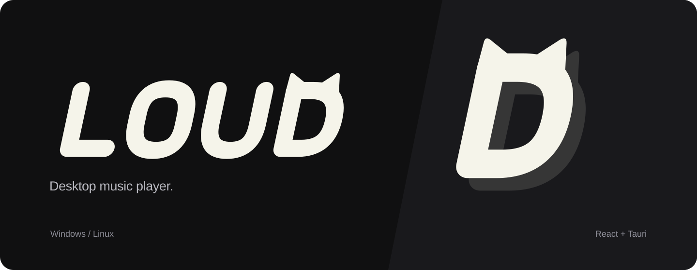

# Loud



A desktop music player for Windows and Linux, built with React and Tauri.

Gapless playback, a 10-band equalizer, synced lyrics, local profiles and Discord Rich Presence.

[Download](https://github.com/Loud-Music/Loud/releases/latest)

## Development

Requires Node.js 22+ and Rust 1.90+. Windows builds need MSVC Build Tools and WebView2; Linux builds need WebKitGTK 4.1 and GTK 3 development packages.

```sh
npm ci
npm run tauri dev
```

## Contributing

Bug reports, fixes and translations are welcome. For larger changes, open an [issue](https://github.com/Loud-Music/Loud/issues) first so we can agree on the scope.

- For bugs, include your LOUD version, operating system, package type and steps to reproduce. Remove personal data and tokens from logs.
- Keep pull requests focused. Describe what changed and how you checked it; include screenshots for UI changes.
- Follow the existing code style and run these checks before submitting:

```sh
npm run build
cargo check --manifest-path src-tauri/Cargo.toml --locked
cargo fmt --manifest-path src-tauri/Cargo.toml -- --check
```

Contributions are distributed under the project's GPLv3 license.

## License

[GPLv3](LICENSE.txt). Third-party notices are in [licenses](licenses/).
